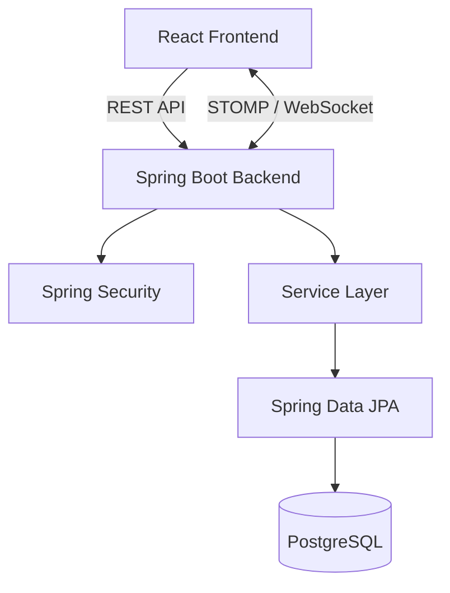

# Meet – Real-Time Messaging & Collaboration Platform

A real-time messaging application built with Spring Boot, React, PostgreSQL, and WebSockets. Supports direct messaging, group chats, typing indicators, and online presence.

## Tech Stack

**Backend**
- Java 21
- Spring Boot 4
- Spring Security and BCrypt
- Spring Data JPA / Hibernate
- Spring WebSocket, STOMP, and SockJS
- PostgreSQL
- Maven

**Frontend**
- React 19
- Vite
- JavaScript
- STOMP.js and SockJS
- Lucide React
- CSS
- Web Audio API

## Features

- User registration and login
- Direct messaging
- Group conversations
- Real-time message delivery
- Message history
- Typing indicators
- Online presence tracking
- User search
- Light and dark themes
- Notification sounds
- Responsive interface

## Architecture

The application uses REST APIs for authentication, user search, conversation management, and message history. WebSockets with STOMP handle real-time messages, typing indicators, and presence events.



## Project Structure

```text
meet/
├── Backend/
│   ├── src/main/java/com/example/demo/
│   │   ├── config/
│   │   ├── controllers/
│   │   ├── dto/
│   │   ├── listeners/
│   │   ├── models/
│   │   ├── repositories/
│   │   ├── services/
│   │   └── BackendApplication.java
│   ├── src/main/resources/
│   ├── ddl.sql
│   ├── Dockerfile
│   └── pom.xml
├── frontend/
│   ├── src/
│   ├── package.json
│   └── vite.config.js
└── README.md
```

## Prerequisites

- JDK 21
- Node.js and npm
- PostgreSQL
- Git

## Getting Started

### 1. Set Up the Database

Create the database:

```sql
CREATE DATABASE chat;
```

Initialize the schema:

```bash
psql -U postgres -d chat -f Backend/ddl.sql
```

### 2. Configure the Backend

Configure the database connection in `Backend/src/main/resources/application.properties`:

```properties
spring.datasource.url=${DB_CHATURL:jdbc:postgresql://localhost:5432/chat}
spring.datasource.username=${DB_USERNAME:postgres}
spring.datasource.password=${DB_PASSWORD}
```

Set `DB_PASSWORD` to your PostgreSQL password.

### 3. Run the Backend

Windows:

```powershell
cd Backend
.\mvnw.cmd spring-boot:run
```

Linux/macOS:

```bash
cd Backend
./mvnw spring-boot:run
```

Backend URL: `http://localhost:8080`

### 4. Run the Frontend

Open another terminal:

```bash
cd frontend
npm install
npm run dev
```

Frontend URL: `http://localhost:5173`

Configure the frontend API and WebSocket URLs using environment variables if necessary:

```env
VITE_API_URL=http://localhost:8080
VITE_WS_URL=http://localhost:8080/ws
```

## API Endpoints

### Authentication

| Method | Endpoint | Description |
|---|---|---|
| POST | `/auth/register` | Register a user |
| POST | `/auth/login` | Log in |
| GET | `/auth/search-user?username={term}` | Search users |

### Chats and Messages

| Method | Endpoint | Description |
|---|---|---|
| GET | `/chats/user/me` | Get the current user's chats |
| POST | `/chats/create-chat` | Create or retrieve a conversation |
| GET | `/chats/{chatId}/messages` | Retrieve message history |
| POST | `/chats/{chatId}/messages` | Send a message using REST |
| GET | `/chats/{chatId}/online-users` | Get online participants |

### WebSocket

Endpoint: `/ws`

| Destination | Direction | Purpose |
|---|---|---|
| `/app/chat/send` | Client → Server | Send a message |
| `/app/typing` | Client → Server | Publish typing status |
| `/topic/chat/{chatId}` | Server → Client | Receive messages |
| `/topic/chat/{chatId}/typing` | Server → Client | Receive typing events |

WebSocket messages use STOMP with `/app` as the application destination prefix and `/topic` and `/queue` as broker prefixes.

## Security Notes

- Passwords are hashed using BCrypt.
- Authenticated operations rely on HTTP session state.
- WebSocket connections and subscriptions must enforce authentication and conversation membership.
- Configure explicit allowed origins when credentials are enabled.
- Use HTTPS and secure session cookies in production.
- Keep database credentials outside version control.

## Future Improvements

- Message pagination and delivery/read receipts
- File and image sharing
- Message search
- Push notifications
- External message broker for horizontal scaling
- Automated tests and production deployment configuration
