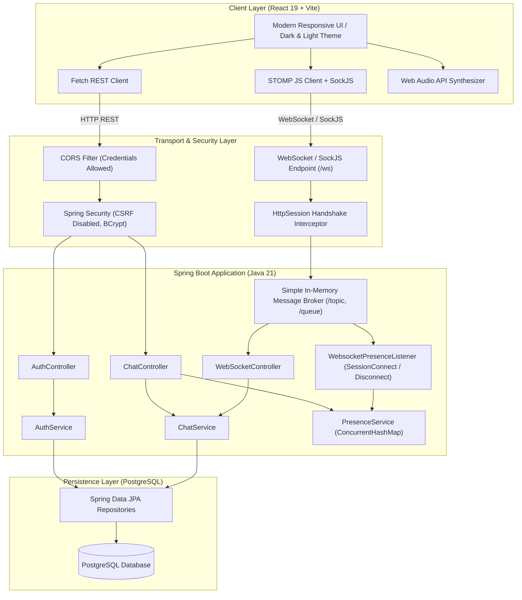
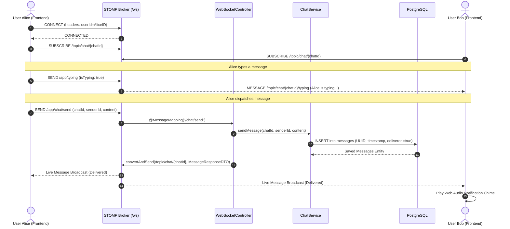
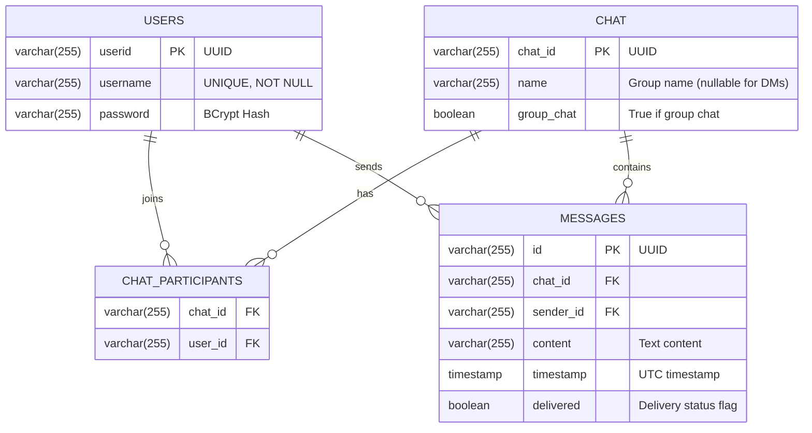

# Meet – Real-Time Messaging & Collaboration Platform

[](https://spring.io/projects/spring-boot)
[](https://www.oracle.com/java/)
[](https://react.dev/)
[](https://vitejs.dev/)
[](https://www.postgresql.org/)
[](https://stomp.github.io/)

A modern, high-performance real-time messaging application engineered with a **Spring Boot 4 (Java 21)** backend, a **React 19 + Vite** frontend, **PostgreSQL** persistence, and full-duplex communication over **STOMP / WebSockets** with SockJS fallback.

---

## Table of Contents

- [Architectural Overview](#architectural-overview)
  - [System Architecture Diagram](#system-architecture-diagram)
  - [Real-Time Messaging Flow](#real-time-messaging-flow)
- [Key Features](#key-features)
- [Technology Stack](#technology-stack)
- [Database Design & Schema](#database-design--schema)
- [Real-Time Protocol & STOMP Broker](#real-time-protocol--stomp-broker)
- [REST API Specification](#rest-api-specification)
- [Frontend Architecture & UI Features](#frontend-architecture--ui-features)
- [Repository Structure](#repository-structure)
- [Getting Started](#getting-started)
  - [Prerequisites](#prerequisites)
  - [Database Configuration](#database-configuration)
  - [Running Backend](#running-backend)
  - [Running Frontend](#running-frontend)
  - [Docker Deployment](#docker-deployment)
- [Configuration & Environment Variables](#configuration--environment-variables)
- [Engineering Design Decisions](#engineering-design-decisions)

---

## Architectural Overview

Meet adopts a decoupled, event-driven client-server architecture balancing **RESTful services** for transactional operations (auth, user discovery, conversation initialization, and message history) with **STOMP-over-WebSocket** for sub-millisecond bidirectional event delivery (live message transmission, typing broadcasts, and user presence tracking).

### System Architecture Diagram



### Real-Time Messaging Flow



---

## Key Features

- **1-on-1 Direct Messaging**: Private conversations created dynamically or retrieved automatically if an existing thread exists between two participants.
- **Multi-Participant Group Chats**: Create named groups with multiple members in a single step.
- **Sub-Second Real-Time Updates**: Messages are delivered instantly across active clients using STOMP broker destinations.
- **Live Typing Indicators**: Real-time typing awareness notifications broadcast to other participants while typing, with automated idle timeouts.
- **Online Presence & Heartbeats**:
  - STOMP session lifecycle tracking (`SessionConnectEvent` and `SessionDisconnectEvent`).
  - Thread-safe multi-session tracking per user account (supports multiple browser tabs simultaneously).
  - Online status badges with active participant counts.
- **Debounced User Search**: Interactive user lookup with SQL wildcards and escaping to find and start conversations seamlessly.
- **Sound Effects via Web Audio API**: Clean synthetic audio chimes generated programmatically using browser oscillators (no external MP3 asset downloads required).
- **Theme Customization**: Dark and Light themes with persistent preferences stored in `localStorage`.
- **Responsive Layout**: Designed for mobile and desktop screens, including collapsible sidebar and fluid message containers.

---

## Technology Stack

### Backend
- **Framework**: Spring Boot 4.0.0
- **Runtime**: Java 21 (Temurin JDK)
- **Security**: Spring Security (BCrypt password encoding, session management)
- **Real-Time Communication**: Spring WebSocket, Spring Messaging, STOMP protocol, SockJS fallback
- **Data Persistence**: Spring Data JPA, Hibernate ORM
- **Database**: PostgreSQL with JDBC driver
- **Boilerplate Reduction**: Project Lombok
- **API Documentation**: SpringDoc OpenAPI / Swagger UI
- **Build Tool**: Maven (`mvnw` wrapper included)

### Frontend
- **Framework**: React 19 (Hooks, Context API)
- **Bundler & Tooling**: Vite 8, Oxlint
- **WebSocket Client**: `@stomp/stompjs` v7 with `sockjs-client`
- **Iconography**: `lucide-react`
- **Styling**: Vanilla CSS Design System with CSS variables and glassmorphism accents
- **Audio Synthesis**: Native Web Audio API (`AudioContext`, `OscillatorNode`, `GainNode`)

---

## Database Design & Schema

The application uses an efficient relational model with UUID keys across all entities:



### Table Definitions (`ddl.sql`)
1. **`users`**: Stores user authentication credentials.
2. **`chat`**: Represents conversations (both 1-on-1 and multi-user groups).
3. **`chat_participants`**: Join table binding participants to conversation rooms (`chat_id`, `user_id`).
4. **`messages`**: Contains timestamped chat logs referencing the parent conversation and sender.

---

## Real-Time Protocol & STOMP Broker

Meet configures a unified WebSocket endpoint at `/ws` supporting native WebSockets and SockJS fallback.

### Broker Topology (`WebsocketConfig.java`)
- **Application Destination Prefix**: `/app` (routes client messages to `@MessageMapping` handlers).
- **Broker Destination Prefixes**: `/topic`, `/queue` (routes messages to subscribed clients).

### STOMP Channel Endpoints

| Direction | Destination | Description | Payload Format |
|---|---|---|---|
| **Client &rarr; Server** | `/app/chat/send` | Transmit a new chat message | `MessageRequestDTO` `{ chatId, senderId, content }` |
| **Client &rarr; Server** | `/app/typing` | Broadcast typing status | `TypingIndicatorDTO` `{ chatId, userId, isTyping }` |
| **Server &rarr; Client** | `/topic/chat/{chatId}` | Stream new messages to room | `MessageResponseDTO` `{ id, chat, sender, content, timestamp, delivered }` |
| **Server &rarr; Client** | `/topic/chat/{chatId}/typing` | Stream typing events to room | `TypingIndicatorDTO` `{ chatId, userId, isTyping }` |

---

## REST API Specification

All REST endpoints operate on `http://localhost:8080` by default.

### 1. Authentication (`/auth`)

#### Register User
- **`POST /auth/register`**
- **Request Body**:
  ```json
  {
    "username": "alex",
    "password": "securepassword123"
  }
  ```
- **Response** (`200 OK`):
  ```json
  {
    "id": "e4b6c31a-6df3-4c59-bfd9-e945c1103c81",
    "username": "alex"
  }
  ```

#### Login User
- **`POST /auth/login`**
- **Request Body**:
  ```json
  {
    "username": "alex",
    "password": "securepassword123"
  }
  ```
- **Response** (`200 OK`):
  ```json
  {
    "id": "e4b6c31a-6df3-4c59-bfd9-e945c1103c81",
    "username": "alex"
  }
  ```
  *Sets HTTP session attribute `userId`.*

#### Search Users
- **`GET /auth/search-user?username={term}`**
- **Session Required**: Yes (authenticated user session).
- **Response** (`200 OK`):
  ```json
  [
    {
      "id": "f8a12d90-1c32-4e00-848e-d9a263158c3a",
      "username": "sarah"
    }
  ]
  ```

---

### 2. Chats & Messaging (`/chats`)

#### Get Current User's Chats
- **`GET /chats/user/me`**
- **Response** (`200 OK`):
  ```json
  [
    {
      "chatId": "a901f4c7-84bc-4421-9989-1300868f7ad4",
      "name": "Design Team",
      "groupChat": true,
      "participantIds": ["f8a12d90-1c32-4e00-848e-d9a263158c3a"]
    }
  ]
  ```

#### Create / Get Direct or Group Chat
- **`POST /chats/create-chat`**
- **Request Body (Direct Chat)**:
  ```json
  {
    "name": "",
    "participantIds": ["f8a12d90-1c32-4e00-848e-d9a263158c3a"],
    "groupChat": false
  }
  ```
- **Request Body (Group Chat)**:
  ```json
  {
    "name": "Engineering Leads",
    "participantIds": [
      "e4b6c31a-6df3-4c59-bfd9-e945c1103c81",
      "f8a12d90-1c32-4e00-848e-d9a263158c3a"
    ],
    "groupChat": true
  }
  ```

#### Retrieve Chat Message History
- **`GET /chats/{chatId}/messages`**
- **Response** (`200 OK`):
  ```json
  [
    {
      "id": "2199b5a8-ef68-45ad-b3e3-780c85c3db73",
      "chat": "a901f4c7-84bc-4421-9989-1300868f7ad4",
      "sender": "e4b6c31a-6df3-4c59-bfd9-e945c1103c81",
      "content": "Hey everyone, sprint review is at 4 PM.",
      "timestamp": "2026-10-17T14:30:00",
      "delivered": true
    }
  ]
  ```

#### Fallback REST Send Message
- **`POST /chats/{chatId}/messages`**
- **Request Body**:
  ```json
  {
    "content": "Acknowledged!"
  }
  ```

#### Online Users in Chat
- **`GET /chats/{chatId}/online-users`**
- **Response** (`200 OK`):
  ```json
  ["e4b6c31a-6df3-4c59-bfd9-e945c1103c81"]
  ```

---

## Frontend Architecture & UI Features

```
frontend/src/
├── components/
│   ├── AuthModal.jsx        # Login & Registration modal dialog
│   ├── ChatArea.jsx         # Message feed, input bar, status & date headers
│   ├── CreateGroupModal.jsx # Multi-select group creator
│   ├── Navbar.jsx           # App branding, user card, theme & audio toggles
│   └── Sidebar.jsx          # Chat filter tabs (All/Direct/Groups) & user search
├── context/
│   └── ToastContext.jsx     # Non-intrusive floating notification toasts
├── services/
│   ├── api.js               # REST communication service layer
│   ├── sound.js             # Web Audio API sine-wave synthesizer
│   └── websocket.js         # STOMP / SockJS connection manager
├── App.jsx                  # Main coordinator, state store & routing logic
├── App.css                  # UI component styles & themes
└── main.jsx                 # Application root & ToastProvider injection
```

### Key UI Features
1. **Dynamic Caching**: User names and conversation aliases are cached in `localStorage` to reduce redundant queries.
2. **Audio Feedback**: Built-in audio cues for outgoing and incoming messages using Web Audio API oscillators.
3. **Optimistic Updates**: Fast responsive state updates when submitting messages.
4. **Smooth Date Grouping**: Date separators ("Today", "Yesterday", or calendar dates) automatically organize message threads.

---

## Repository Structure

```
meet/
├── Backend/
│   ├── src/main/java/com/example/demo/
│   │   ├── config/              # Security, CORS, WebSocket broker configs
│   │   ├── controllers/         # REST and WebSocket STOMP controllers
│   │   ├── dto/                 # Request and Response transfer objects
│   │   ├── listeners/           # SessionConnect & SessionDisconnect handlers
│   │   ├── models/              # JPA entities (Users, Chat, Messages)
│   │   ├── repositories/        # Spring Data JPA queries & projections
│   │   ├── services/            # Business logic (Auth, Chat, Presence)
│   │   └── BackendApplication.java
│   ├── src/main/resources/
│   │   └── application.properties # Server port, JDBC URL, Hibernate settings
│   ├── ddl.sql                  # PostgreSQL database DDL schema script
│   ├── Dockerfile               # Multi-stage container build
│   └── pom.xml                  # Maven dependencies & build specification
├── frontend/
│   ├── src/                     # React application source code
│   ├── index.html               # Main HTML entry point
│   ├── package.json             # NPM dependencies & scripts
│   └── vite.config.js           # Vite dev-server configuration
└── README.md                    # Project documentation
```

---

## Getting Started

### Prerequisites

Make sure the following tools are installed:
- **Java Development Kit (JDK) 21** or higher
- **Node.js 18+** & **npm**
- **PostgreSQL 14+**
- **Git**

---

### Database Configuration

1. Launch PostgreSQL and create the database:
   ```sql
   CREATE DATABASE chat;
   ```
2. Initialize the schema using the provided script:
   ```bash
   psql -U postgres -d chat -f Backend/ddl.sql
   ```

---

### Running Backend

1. Navigate to the `Backend` directory:
   ```bash
   cd Backend
   ```
2. Configure credentials in `src/main/resources/application.properties` or provide environment variables:
   ```properties
   spring.datasource.url=jdbc:postgresql://localhost:5432/chat
   spring.datasource.username=postgres
   spring.datasource.password=yourpassword
   ```
3. Run the Spring Boot application:
   - On Windows (PowerShell / CMD):
     ```cmd
     .\mvnw.cmd spring-boot:run
     ```
   - On Linux / macOS:
     ```bash
     ./mvnw spring-boot:run
     ```
4. The backend server starts on `http://localhost:8080`.
   - Swagger / OpenAPI UI: `http://localhost:8080/swagger-ui/index.html`

---

### Running Frontend

1. Open a new terminal and navigate to the `frontend` directory:
   ```bash
   cd frontend
   ```
2. Install dependencies:
   ```bash
   npm install
   ```
3. Start the Vite development server:
   ```bash
   npm run dev
   ```
4. Open your browser and visit: `http://localhost:5173`

---

### Docker Deployment

To build and run the backend inside a Docker container:

```bash
cd Backend
docker build -t meet-backend .
docker run -p 8080:8080 \
  -e DB_CHATURL=jdbc:postgresql://host.docker.internal:5432/chat \
  -e DB_USERNAME=postgres \
  -e DB_PASSWORD=yourpassword \
  meet-backend
```

---

## Configuration & Environment Variables

### Backend (`application.properties`)

| Property / Environment Variable | Default Value | Description |
|---|---|---|
| `DB_CHATURL` | `jdbc:postgresql://localhost:5432/chat` | PostgreSQL JDBC connection URL |
| `DB_USERNAME` | `postgres` | Database username |
| `DB_PASSWORD` | `maddy` | Database password |
| `server.port` | `8080` | HTTP server port |
| `server.servlet.session.cookie.same-site` | `Lax` | Session cookie SameSite policy |
| `server.servlet.session.cookie.secure` | `false` | Session cookie SSL requirement |

### Frontend (`.env` or Environment)

| Variable | Default Value | Description |
|---|---|---|
| `VITE_API_URL` | `http://localhost:8080` | REST API base URL |
| `VITE_WS_URL` | Derived from `VITE_API_URL` (`ws://localhost:8080`) | WebSocket server URL |

---

## Engineering Design Decisions

1. **WebSocket + REST Hybrid Protocol**:
   - Authentication and historical message pagination are served over REST to take advantage of standard HTTP caching, cookies, and error response semantics.
   - Live messages and typing indicators travel through STOMP message channels to minimize latency and eliminate polling overhead.
2. **Stateful Session Presence Tracking**:
   - Instead of continuously hitting the database for heartbeat updates, `PresenceService` maintains `ConcurrentHashMap` instances indexed by `userId` and `sessionId`.
   - This handles multiple browser tabs per user seamlessly without generating false "offline" triggers when one tab closes.
3. **No External Sound Assets**:
   - Notification sounds are synthesized in real-time via the browser's Web Audio API using pure sine oscillators and exponential gain ramps, avoiding network latency and missing asset errors.
4. **Extensible Security Boundary**:
   - `CorsConfig` is configured with `setAllowCredentials(true)` and wildcard origins to ensure seamless cookie exchange during local development and cross-origin deployments.